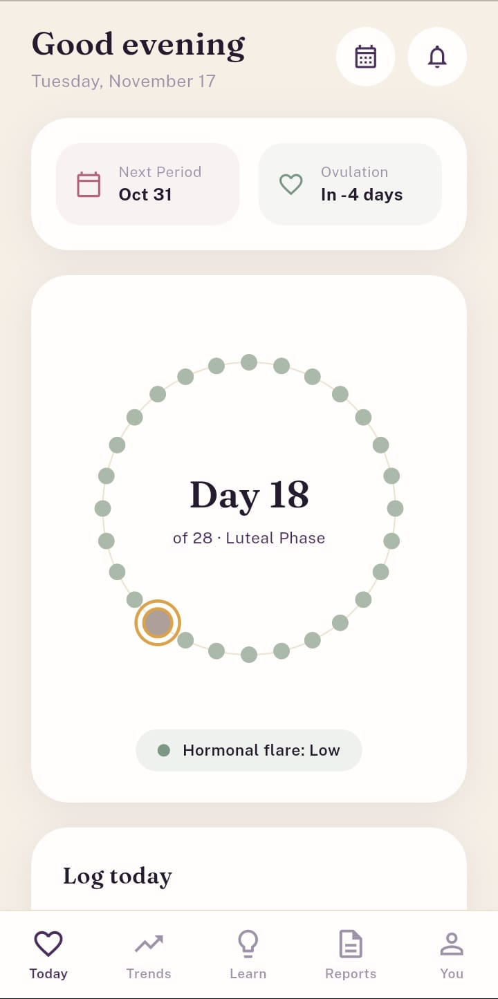
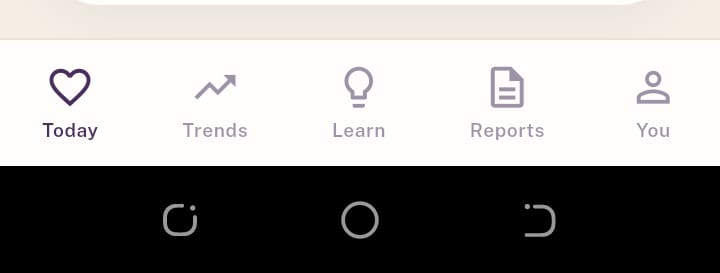
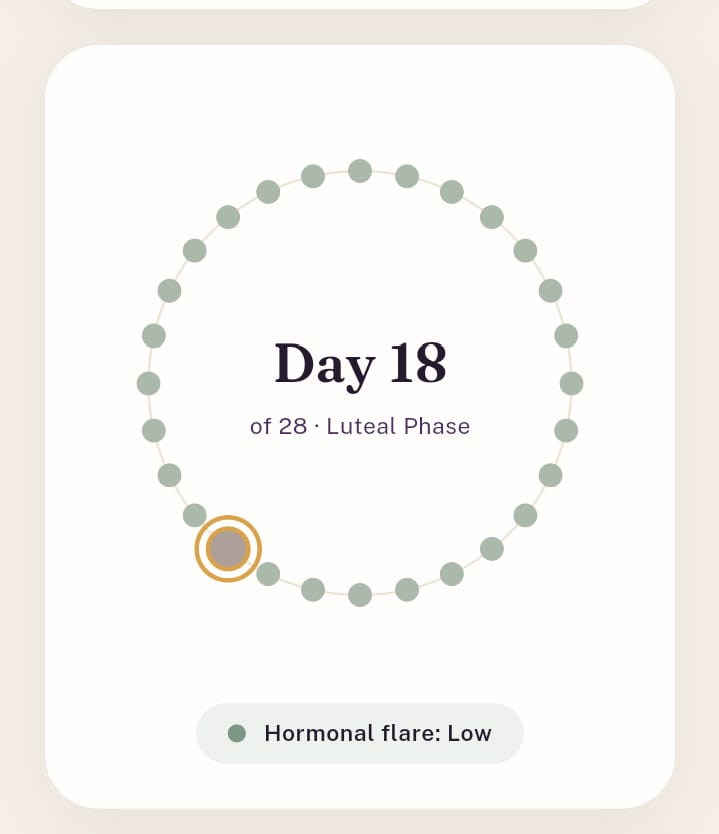

# Week 01 – Cadence App Setup and Design

## Overview
During the first week, I started developing the Cadence mobile application. I created the Flutter project and worked on the basic design, home screen, navigation menu and Cycle Ring.

## Work Completed
- Created the Cadence Flutter project.
- Organized the application folders and files.
- Selected colours and fonts.
- Designed the home screen.
- Created the bottom navigation menu.
- Designed the 28-day Cycle Ring.

## Technologies Used
- Flutter
- Dart
- Android Studio
- Material Design
- Google Fonts

## Screenshots and Work Evidence

### 1. Cadence Home Screen

Created the main screen with a welcome message, cycle information and other important details.

### 2. Bottom Navigation Menu

Created navigation options for Today, Trends, Learn, Reports and You.

### 3. Cycle Ring Design

Designed a circular Cycle Ring to display the current cycle day, cycle length and phase.

## Skills Learned
- Flutter project setup.
- Mobile application designing.
- Working with Flutter widgets.
- Creating navigation menus.
- Designing custom UI elements.

## Result
Successfully created the basic design and main screens of the Cadence application. The project is now ready for further feature development.

**Time Allocation:** Approximately 40 hours.
