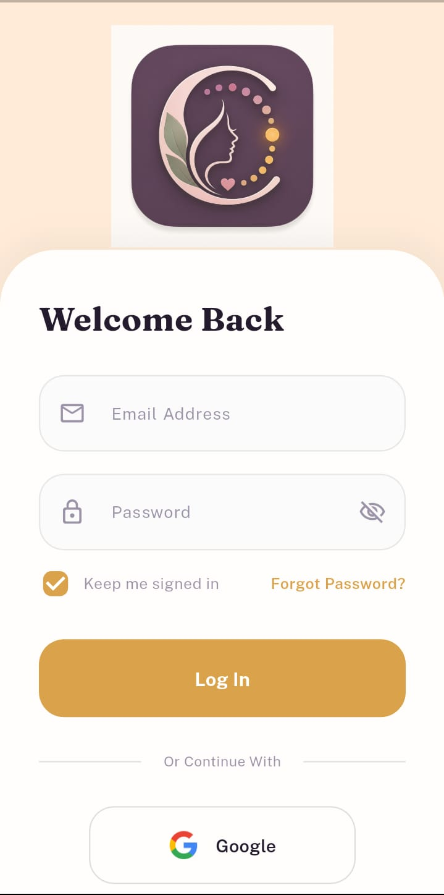
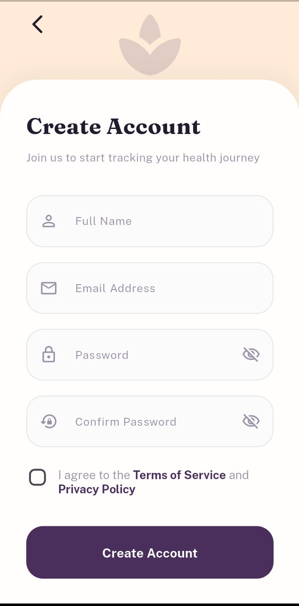
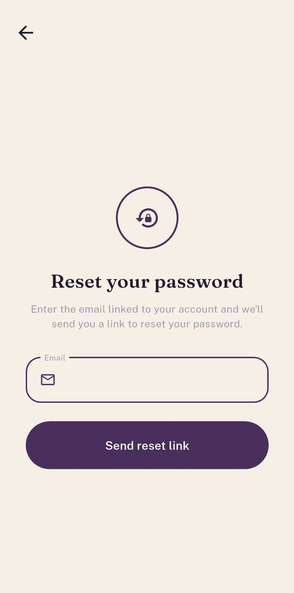
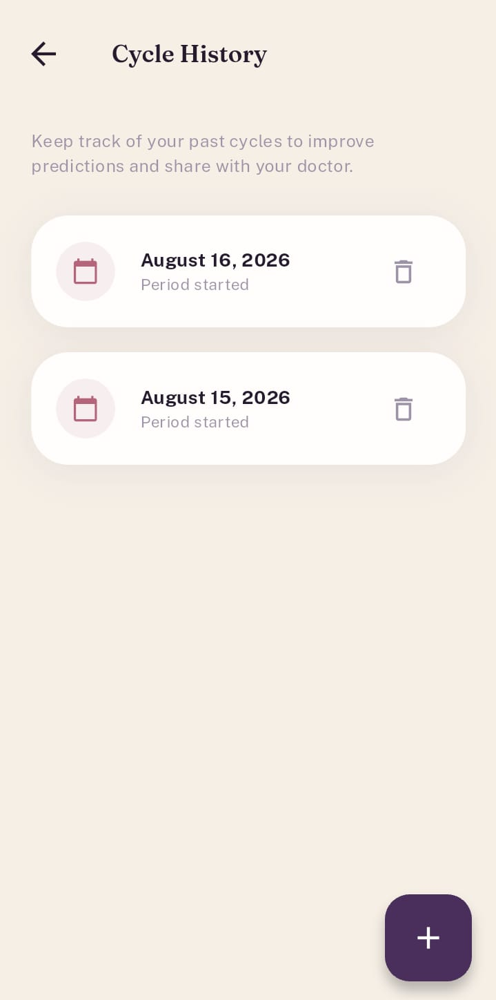
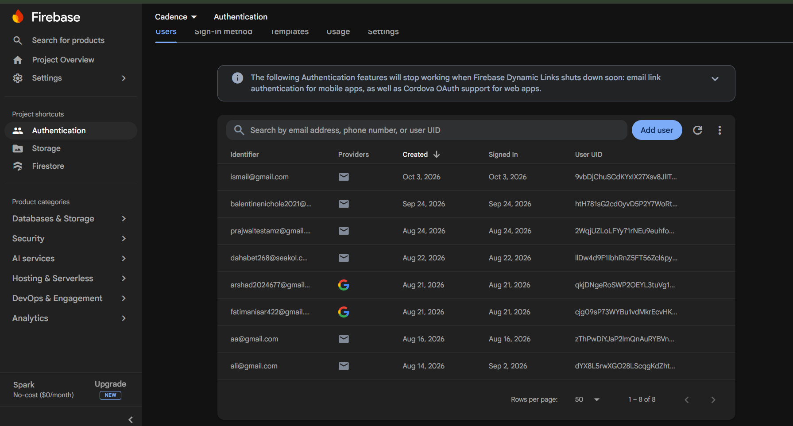

# Week 02 – Login, Signup and User Onboarding

## Overview

During the second week, I worked on the login, signup and onboarding features of the Cadence application. The main purpose was to allow users to create accounts, log in and provide their basic information.

## Work Completed

- Designed the login screen with email and password fields.
- Created a signup screen for new users.
- Connected Firebase Authentication with the application.
- Added a Forgot Password option.
- Created onboarding screens for new users.
- Added health condition selection options.
- Added tracking goals and cycle length selection.
- Added a date picker for the last period date.
- Improved navigation between authentication and home screens.

## Technologies Used

- Flutter
- Dart
- Firebase Authentication
- Android Studio
- PageView
- Form Validation

## Screenshots and Work Evidence

### 1. Login Screen

Created a login screen where existing users can enter their email and password.

### 2. Signup Screen

Created a registration screen to allow new users to create an account.

### 3. Forgot Password

Added a password reset option to help users recover access to their accounts.

### 4. User Onboarding

Created onboarding screens where users can select their health condition, tracking goals, last period date and cycle length.

### 5. Firebase Authentication

Connected the application with Firebase Authentication to manage user accounts.

## Challenges Faced

I faced some navigation problems after successful login. Sometimes the application did not open the correct screen.

## Solutions Applied

I improved the authentication process and corrected the navigation so users could move to the appropriate screen after login.

## Skills Learned

- Firebase Authentication
- Login and signup development
- Form validation
- User onboarding
- Flutter screen navigation

## Result

Successfully developed the login, signup, forgot-password and onboarding features and connected the application with Firebase Authentication.

**Time Allocation:** Approximately 40 hours.
