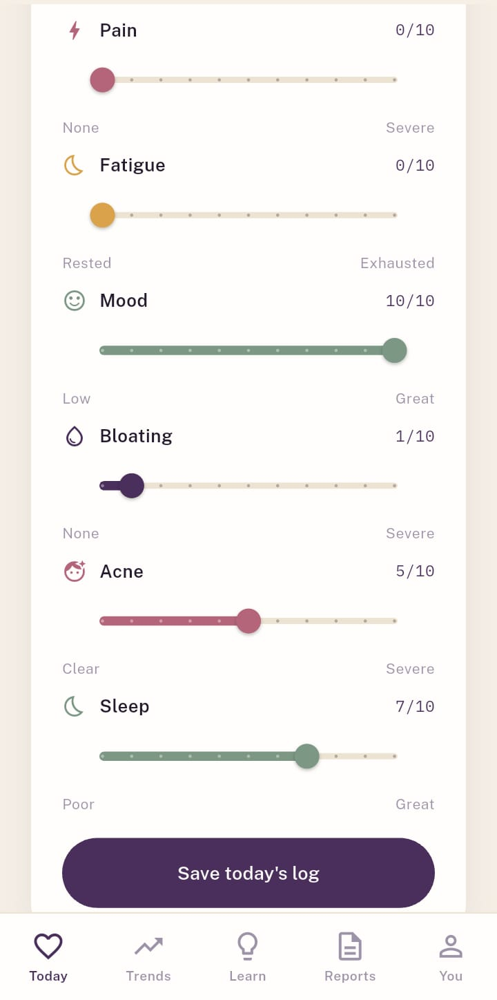
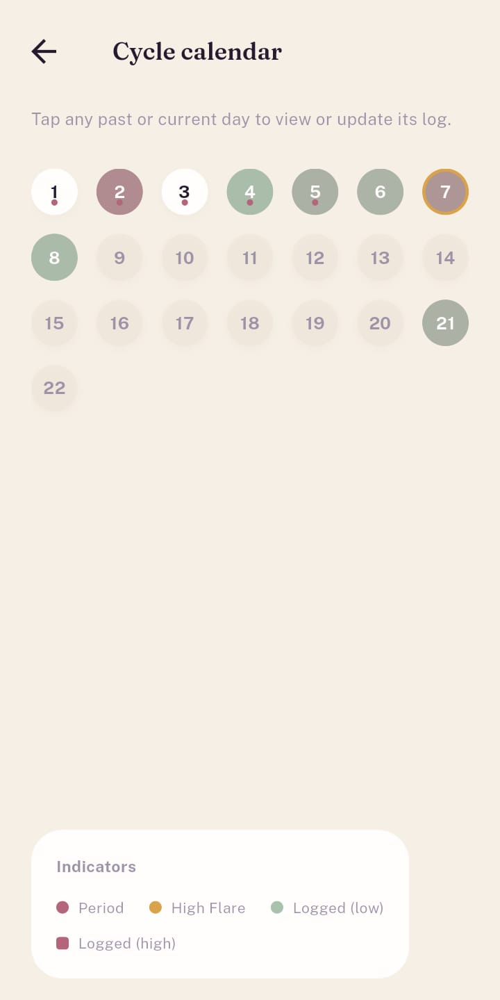
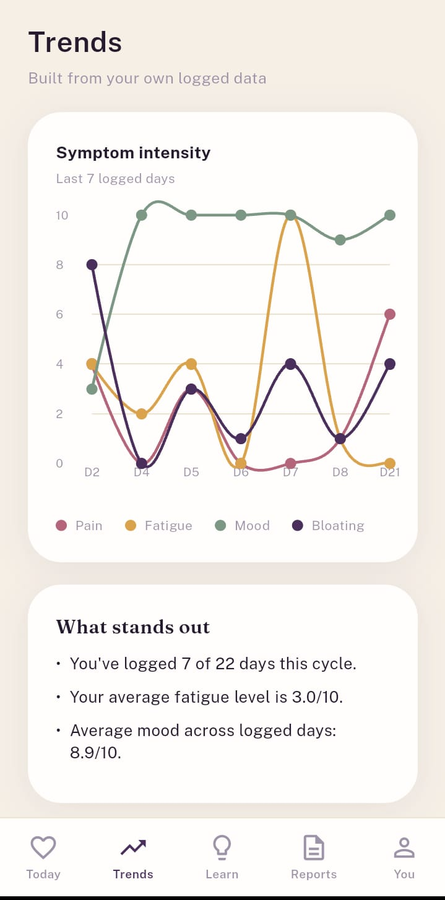
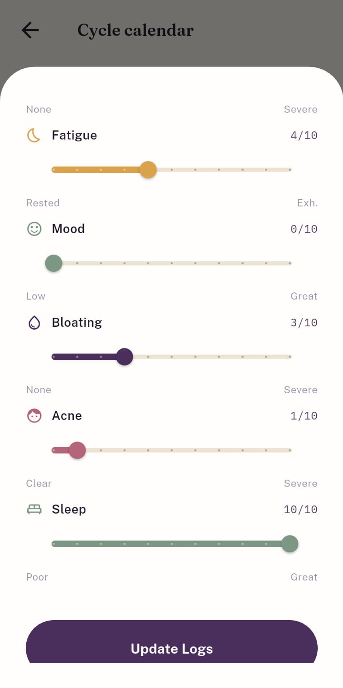

# Week 03 – Daily Symptom Tracking and Calendar

## Overview

During the third week, I worked on the daily symptom tracking and calendar features of the Cadence application. The main purpose was to allow users to record their daily health information and view their previous records.

## Work Completed

- Created a daily symptom tracking screen.
- Added sliders for pain, fatigue, mood and bloating levels.
- Connected the tracking information with the Cycle Ring.
- Created a calendar screen to view previous dates.
- Added an option to view and update daily records.
- Developed the Trends section with charts.
- Connected the charts with saved symptom information.
- Improved the display of daily tracking records.

## Technologies Used

- Flutter
- Dart
- SharedPreferences
- fl_chart
- Android Studio

## Screenshots and Work Evidence

### 1. Daily Symptom Tracking

Created a screen where users can record their pain, fatigue, mood and bloating levels.

### 2. Calendar Screen

Created a calendar where users can select previous dates and view their saved daily information.

### 3. Trends Chart

Added charts to display symptom information based on the user's saved records.

### 4. Daily Record Details

Added the option to view and update records for selected dates.

## Challenges Faced

Managing records for different dates and displaying updated information on the correct screens was challenging.

## Solutions Applied

Improved the data-saving process and connected the calendar, tracking screen and charts with the saved records.

## Skills Learned

- Daily data handling
- Calendar development
- Flutter sliders and widgets
- Chart creation
- Managing information between screens

## Result

Successfully developed the daily symptom tracking, calendar and Trends features. Users can record their symptoms and view their previous information.

**Time Allocation:** Approximately 40 hours.
