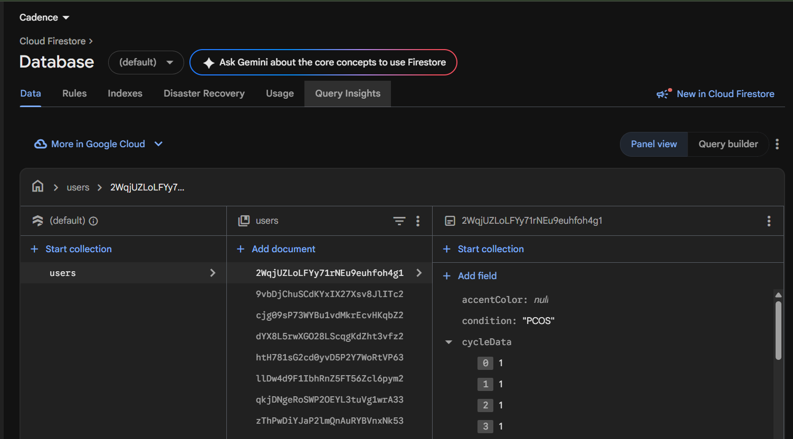
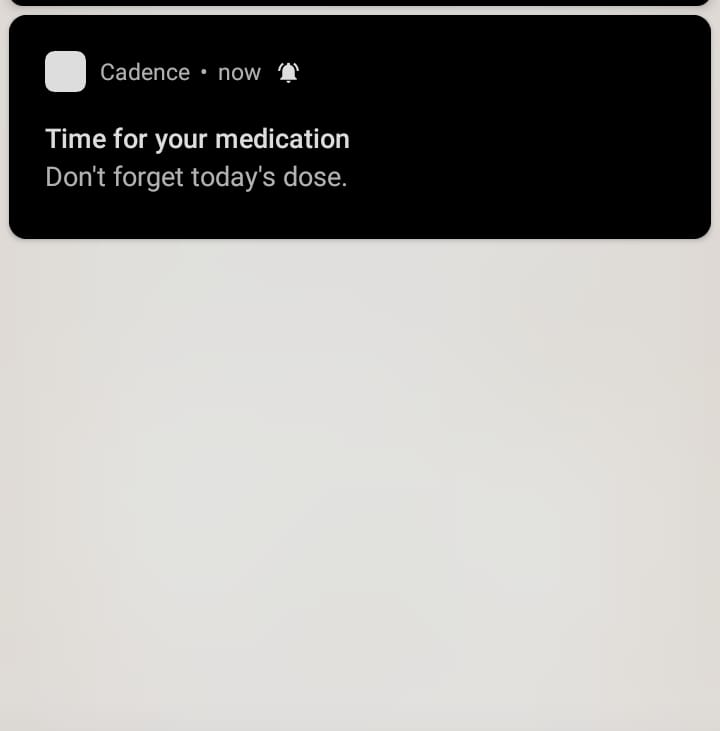
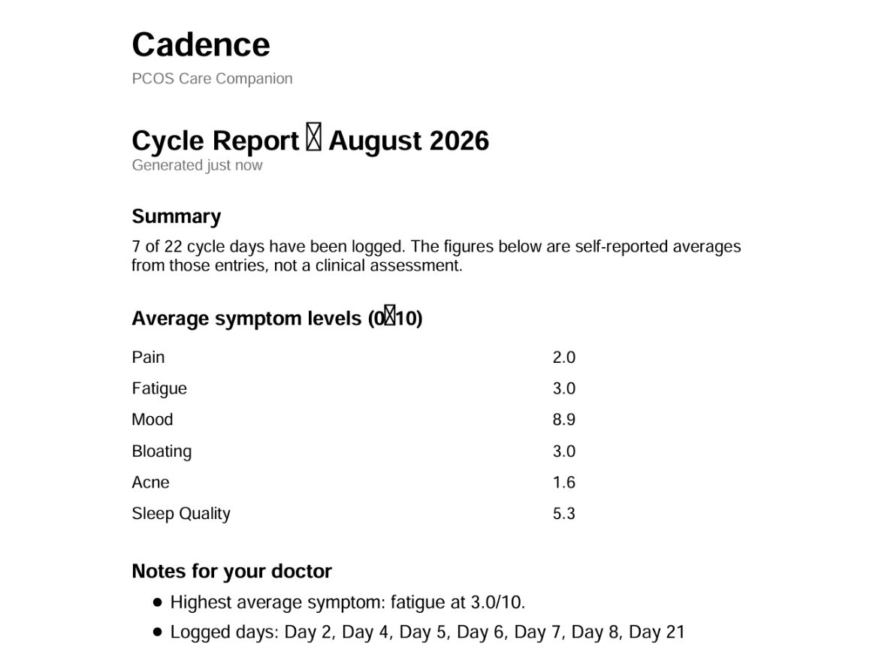
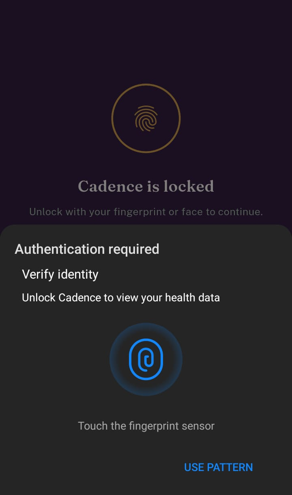
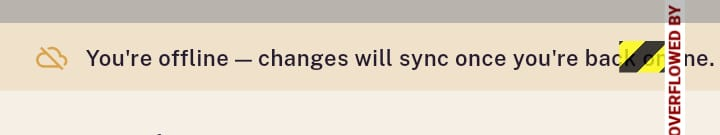

# Week 04 – Firebase Database and Additional Features

## Overview

During the fourth week, I worked on improving the Cadence application by adding database connectivity and additional features. I focused on saving user information, notifications, PDF reports and application security.

## Work Completed

- Connected the application with Firebase Cloud Firestore.
- Added functionality to save and retrieve user information.
- Improved data synchronization between the application and Firebase.
- Added local notifications for daily reminders.
- Created a PDF health report feature.
- Added an optional biometric app lock.
- Improved offline handling.
- Added a daily tracking streak counter.
- Worked on the account deletion feature.
- Fixed errors and tested the application.

## Technologies Used

- Flutter
- Dart
- Firebase Authentication
- Cloud Firestore
- flutter_local_notifications
- PDF package
- share_plus
- local_auth
- Firebase Hosting

## Screenshots and Work Evidence

### 1. Firebase Firestore

Connected Cadence with Cloud Firestore to save and retrieve user information.

### 2. Notifications

Added local notifications to remind users about daily tracking and other activities.

### 3. PDF Health Report

Created a PDF report feature to allow users to generate and share their health information.

### 4. Biometric App Lock

Added an optional security feature using the device's biometric authentication.

### 5. Offline Support

Improved the application so users could continue working when an internet connection was unavailable.

## Challenges Faced

I faced some problems with saving and updating information between local storage and Firebase. Handling notification permissions and offline functionality also required additional testing.

## Solutions Applied

Improved the data synchronization process, handled notification permissions and tested the additional features. I also fixed problems related to application settings and data saving.

## Skills Learned

- Firebase Cloud Firestore
- Data synchronization
- Local notifications
- PDF report generation
- Biometric authentication
- Offline application handling
- Application testing

## Result

Successfully improved the Cadence application by adding Firebase database connectivity, notifications, PDF reports, biometric security and offline support.

**Time Allocation:** Approximately 40 hours.
