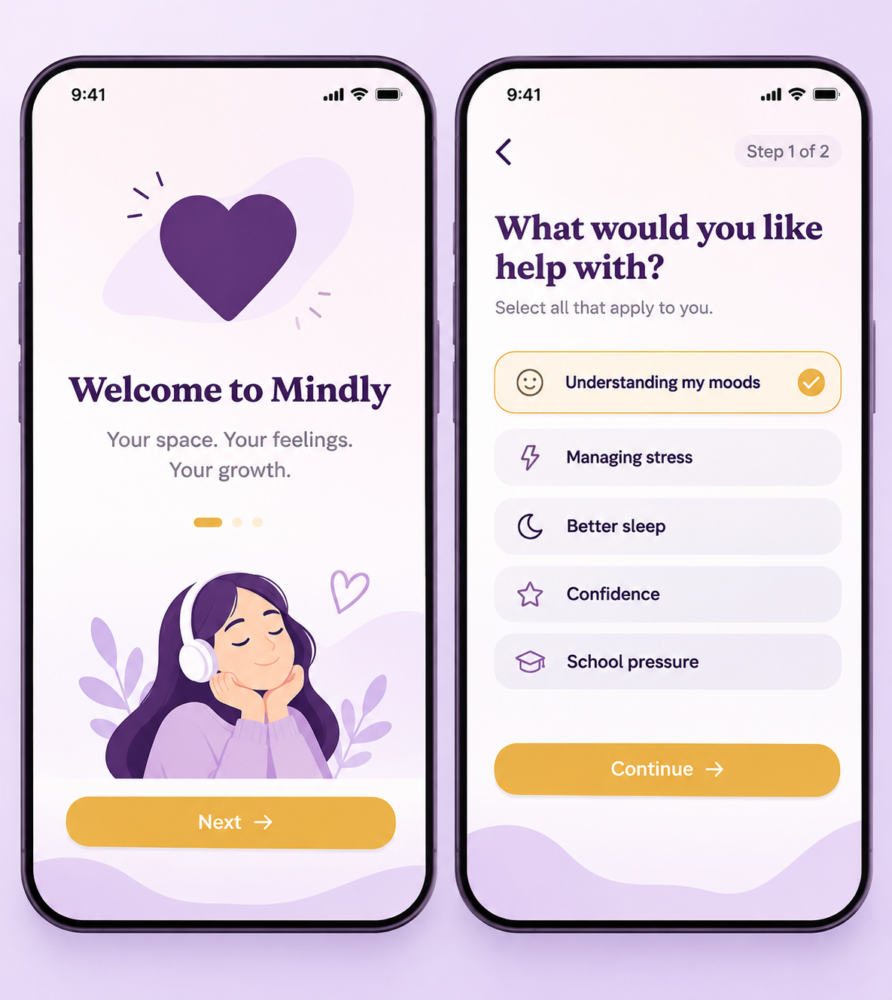
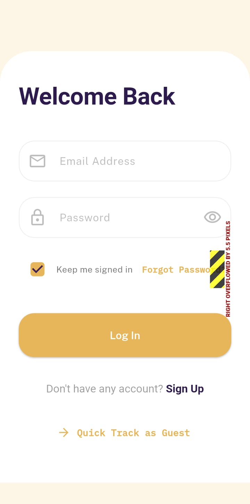
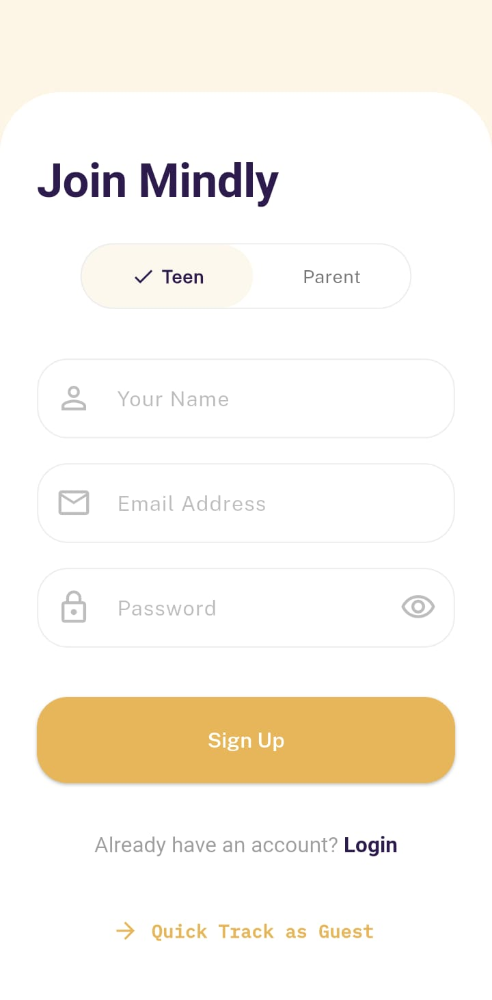

# Week 05 – Mindly App Setup and Design

## Overview

During the fifth week, I started developing the Mindly mobile application. I focused on setting up the Flutter project, designing the application and creating the login and signup features.

## Work Completed

- Created a new Flutter project named Mindly.
- Organized the application structure.
- Set up Riverpod for managing application data and state.
- Connected Firebase Authentication.
- Added email and password login and signup.
- Added a guest login option.
- Connected the application with Cloud Firestore.
- Created light and dark themes.
- Designed the Teen and Parent role selection.
- Created the basic onboarding screens with privacy information.

## Technologies Used

- Flutter
- Dart
- Riverpod
- Firebase Authentication
- Cloud Firestore
- SharedPreferences
- Google Fonts
- Android Studio

## Screenshots and Work Evidence

### 1. Mindly Welcome Screen

Created the basic welcome screen and application design.

### 2. Login Screen

Created a login screen where registered users can enter their email and password.

### 3. Signup Screen

Created a signup screen for new users to register in the application.

### 4. Light and Dark Themes

Created two display themes for Mindly. The Light Theme uses soft colours, while the Dark Theme provides a darker interface. Both themes maintain the same layout and design to give users a consistent experience.

### 5. Teen and Parent Options

Added separate role options for Teen and Parent users. Also added guest access for users who want to use the application without creating an account.

## Challenges Faced

One challenge was managing registered users and guest users through the same application. I also needed to organize the screens for Teen and Parent users.

## Solutions Applied

Used Firebase Authentication for email and password accounts and anonymous authentication for guest access. Organized the application to support different user roles.

## Skills Learned

- Flutter project development
- Riverpod state management
- Firebase Authentication
- Cloud Firestore
- Light and dark themes
- Guest login
- User role management

## Result

Successfully created the basic Mindly application structure, authentication system, guest login option and light and dark themes.

**Time Allocation:** Approximately 40 hours.
