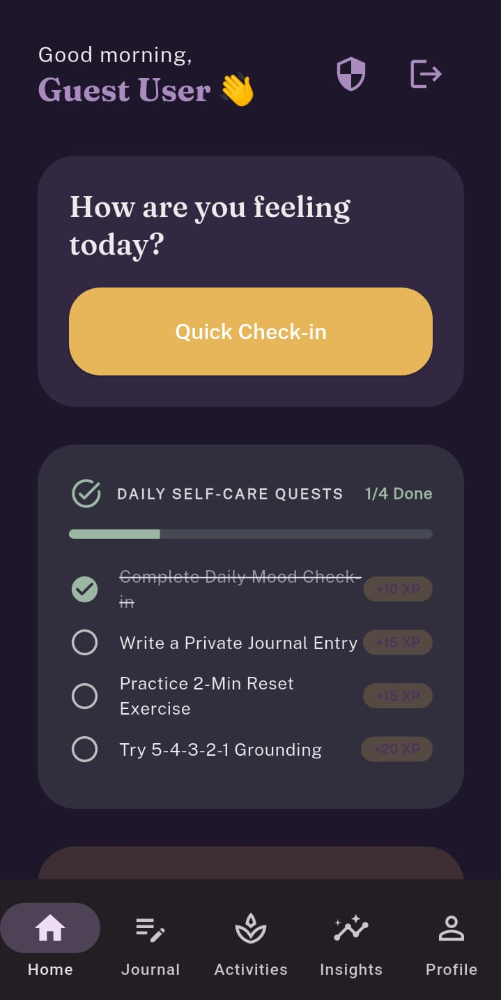
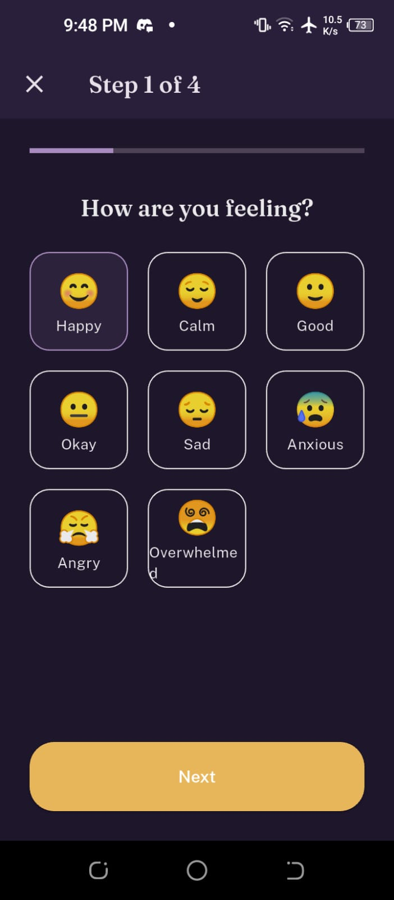
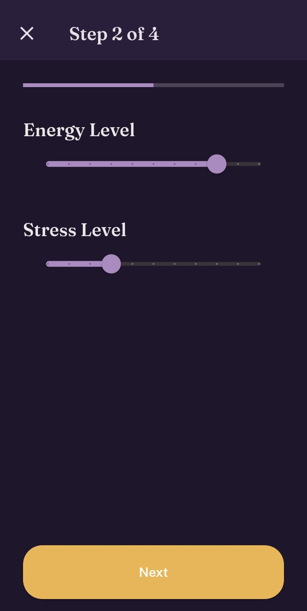
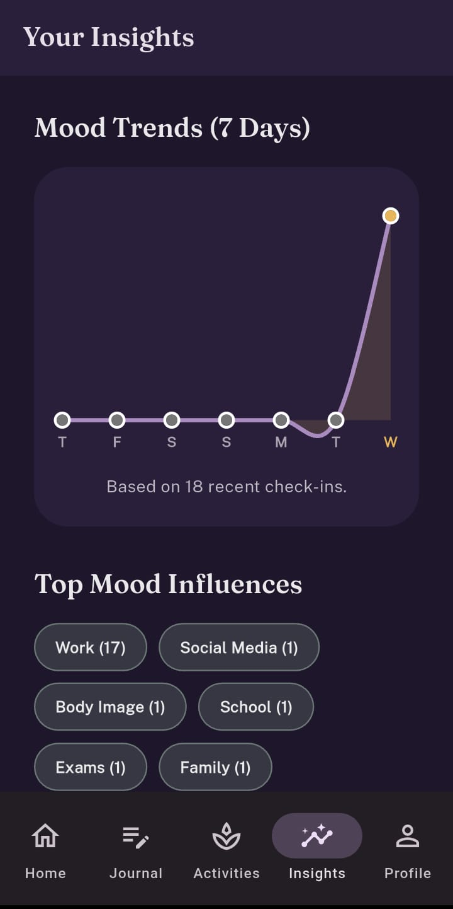
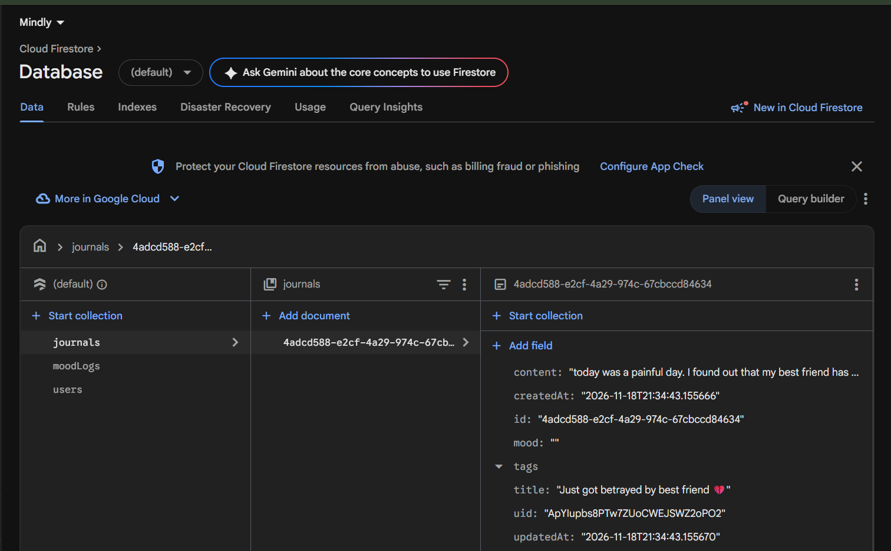

# Week 06 – Home Dashboard and Mood Tracking

## Overview

During the sixth week, I worked on the main dashboard and mood tracking features of the Mindly application. The main purpose was to allow users to record their daily feelings and view their mood information.

## Work Completed

- Designed the main Home Dashboard for Teen users.
- Added a welcome message on the home screen.
- Created a daily self-care activities section.
- Added a mood check-in feature.
- Added options to record mood, energy and stress levels.
- Added a notes field for daily feelings.
- Created a weekly mood chart.
- Connected mood records with Firebase Firestore.
- Improved the dashboard layout and navigation.

## Technologies Used

- Flutter
- Dart
- Firebase Cloud Firestore
- Riverpod
- fl_chart
- Android Studio

## Screenshots and Work Evidence

### 1. Home Dashboard

Created the main dashboard with a welcome message and daily self-care activities.

### 2. Mood Check-in

Created a mood check-in screen where users can select and record their current feelings.

### 3. Energy and Stress Levels

Added options for users to record their energy and stress levels.

### 4. Weekly Mood Chart

Created a weekly chart to display mood information based on saved records.

### 5. Firebase Mood Records

Connected mood tracking information with Firebase Firestore to save and retrieve user records.

## Challenges Faced

Saving mood information and displaying updated records on the dashboard was challenging. I also needed to make sure that the weekly chart displayed the correct information.

## Solutions Applied

Connected the mood tracking screens with Firebase Firestore and improved the way records were saved and displayed. I also tested the chart using saved information.

## Skills Learned

- Dashboard development
- Mood tracking
- Firebase database operations
- Chart creation
- Flutter state management
- Application testing

## Result

Successfully developed the Mindly Home Dashboard, mood check-in feature and weekly mood chart. Users can record their daily feelings and view their mood information.

**Time Allocation:** Approximately 40 hours.
