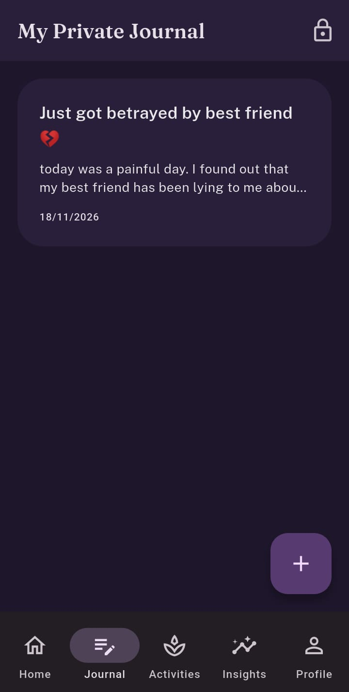
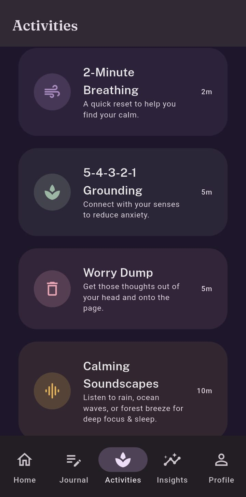
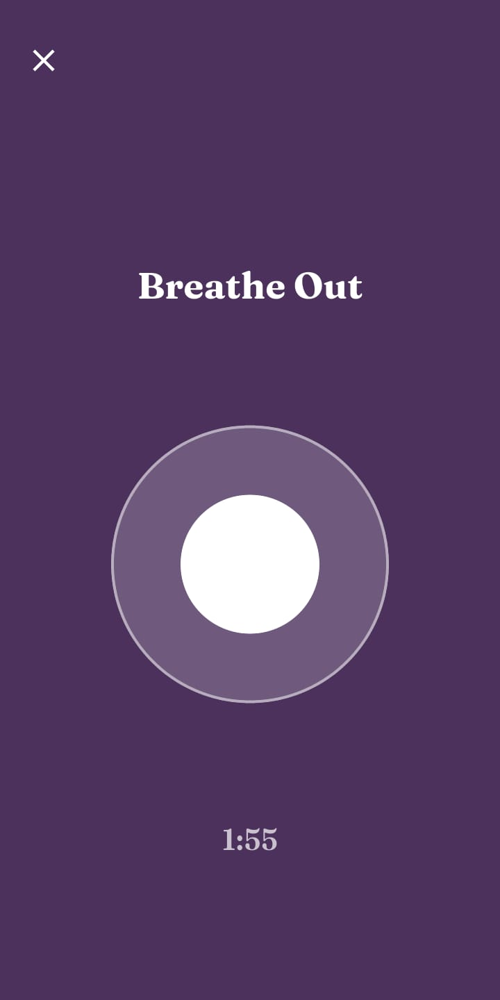
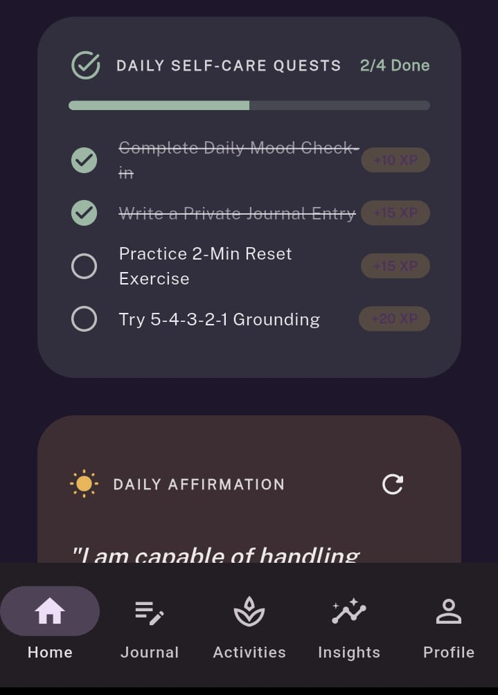

# Week 07 – Journal and Self-Care Activities

## Overview

During the seventh week, I worked on the Journal and Activities sections of the Mindly application. The main purpose was to allow users to write their personal thoughts and complete simple self-care activities.

## Work Completed

- Created the Journal screen.
- Designed the interface for writing personal journal entries.
- Added options to save and view journal entries.
- Created the Activities screen.
- Added daily self-care tasks.
- Designed simple relaxation and grounding activities.
- Added progress indicators for daily activities.
- Improved the navigation between Home, Journal and Activities screens.
- Worked on the overall design of the application.

## Technologies Used

- Flutter
- Dart
- Riverpod
- Firebase Cloud Firestore
- Android Studio

## Screenshots and Work Evidence

### 1. Journal Screen

Created a Journal section where users can manage their personal writing.

### 2. Activities Screen

Created an Activities section to display daily self-care tasks.

### 3. Relaxation Exercises

Worked on simple relaxation and grounding activities to help users manage their daily stress.

### 4. Activity Progress

Added progress indicators to show completed daily activities.

## Challenges Faced

Designing simple journal and activity screens while keeping the application easy to use was challenging.

## Solutions Applied

Organized the screens clearly and used consistent colours, buttons and layouts throughout the application.

## Skills Learned

- Journal screen development
- Flutter UI design
- User input handling
- Activity management
- Progress tracking
- Mobile application navigation

## Result

Successfully worked on the Journal and Activities sections of Mindly, improving the application's daily self-care experience.

**Time Allocation:** Approximately 40 hours.
