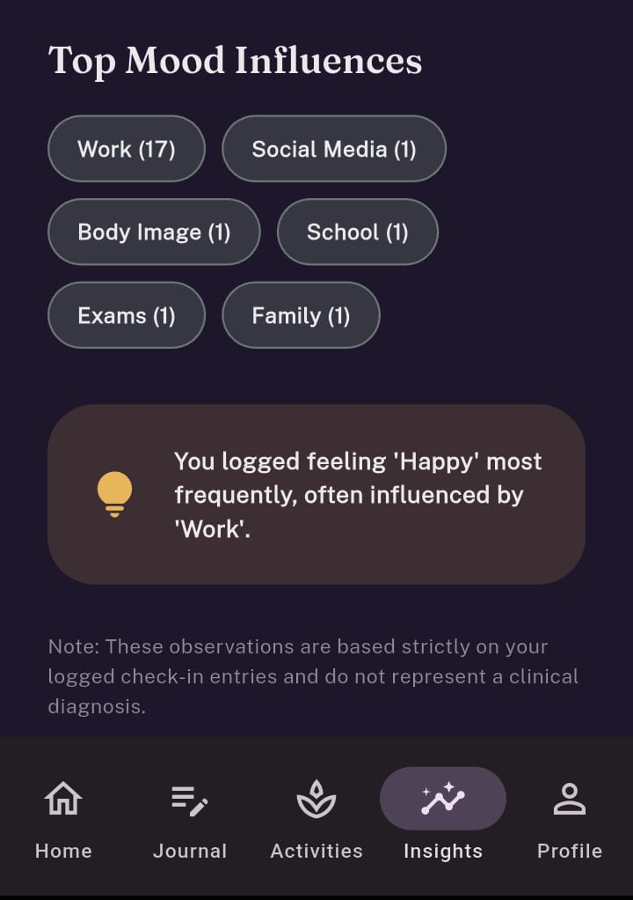
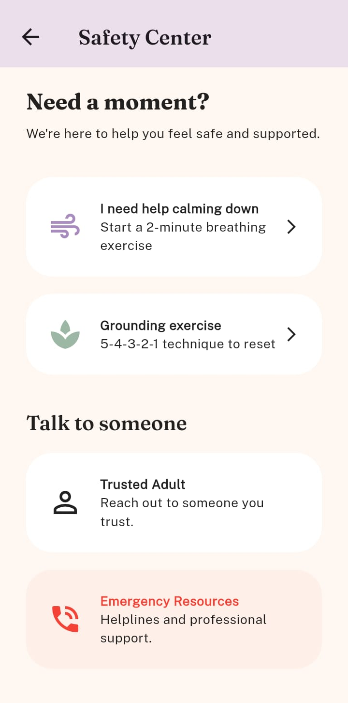
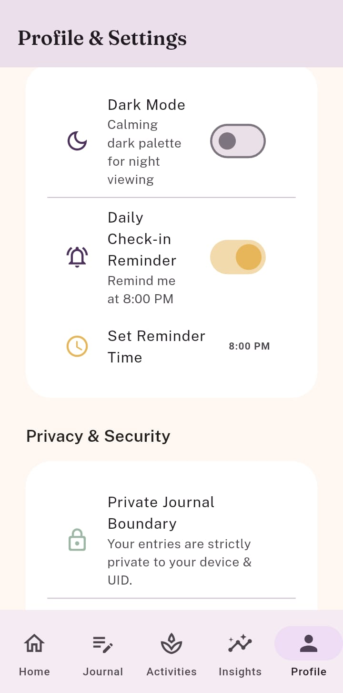
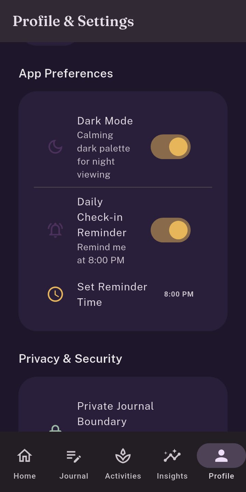

# Week 08 – Data Insights, Parent Dashboard and Final Improvements

## Overview

During the eighth week, I worked on the remaining features of the Mindly application. I focused on displaying mood information, creating a Parent Dashboard, adding safety options and improving application settings.

## Work Completed

- Created the Data Insights section to display mood trends and check-in information.
- Added information about common factors that affect users' moods.
- Kept private journal entries separate from the Parent Dashboard.
- Created a Safety Center with support options and trusted contacts.
- Added emergency helpline information.
- Improved the application settings.
- Added dark mode and daily reminder options.
- Tested login and database features.
- Fixed navigation and screen layout problems.
- Tested the application on different screen sizes.

## Technologies Used

- Flutter
- Dart
- Firebase Authentication
- Cloud Firestore
- Riverpod
- Android Studio
- CMake

## Screenshots and Work Evidence

### 1. Data Insights

Created an insights section to display mood trends, common influences and user check-in information.

### 2. Safety Center

Added a Safety Center with support options, trusted contacts and emergency helpline information.

### 3. Application Settings

Improved the settings section and added options for application preferences and daily reminders.

### 4. Dark Mode and Reminders

Worked on dark mode and daily reminder settings to improve the application experience.

## Challenges Faced

One challenge was showing useful wellbeing information to parents while keeping users' private journal entries confidential. I also faced some layout and navigation issues during final testing.

## Solutions Applied

Separated general wellbeing information from private journal entries. Improved screen navigation, corrected layout problems and tested the application on different screen sizes.

## Skills Learned

- Data visualization
- Dashboard development
- Firebase database management
- User privacy
- Application settings
- Dark mode implementation
- Application testing and debugging

## Result

Successfully worked on the Data Insights, Parent Dashboard, Safety Center and application settings. Also improved the overall application through testing and fixing layout and navigation problems.

**Time Allocation:** Approximately 40 hours.
